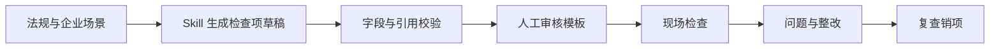

# EHS Agent

[English](README.en.md) · **中文**

### EHS Loop · 制造业现场检查与整改闭环

**从法规原文，到可审核的检查项，再到整改复查。**

[产品案例](docs/case-study.md) · [能力与边界](#当前边界) · [演示路径](#演示从这个任务开始)

> 本仓库当前提供产品案例文档。下述实现说明来自本地 EHS Loop 原型；应用源码与可运行发布包尚未在本仓库提供。

## 它能帮 EHS 人员做什么

“下周要检查车间，我需要把法规要求整理成现场能执行、出了问题能继续跟踪的清单。”

EHS Loop 把法规、检查模板、现场检查、问题登记和整改复查接在同一条工作流中。AI 助手负责提出检查项草稿，保留原文引用、适用条件、证据要求与复查要点；人员审核之后，再进入实际检查。

| 人员要做的事 | 本地原型提供的帮助 |
| --- | --- |
| 把法规整理成检查清单 | 结合所选法规、行业、地区和企业补充说明生成草稿 |
| 核查检查项的依据 | 通过段落编号绑定库内条号和连续原文，校验引用 |
| 识别条件和信息缺口 | 展示适用条件、待补充信息和未覆盖义务 |
| 带着清单去检查 | 审核模板、创建检查任务、记录检查结果 |
| 跟踪发现的问题 | 衔接问题登记、整改跟踪与复查销项 |

## 五个让检查有依据、整改有下文的设计

### 01　先说明检查场景，再生成清单

相同条文，对不同工艺和作业条件的意义可能不同。输入包含行业、地区和企业/工艺补充说明；模型返回场景摘要、所需补充信息与尚未覆盖的义务。

设计重点是把信息不足显式保留，避免将一份通用清单误认为企业全部义务已被覆盖。

### 02　法规转检查项是一套可维护的 Skill

后端每次生成时读取运行目录中的 Skill 与示例。规则覆盖检查对象、方法、判定标准、证据、适用条件、依据关系、整改方向和复查要点。

| 草稿字段 | 帮助审核者判断什么 |
| --- | --- |
| 检查对象、方法、标准 | 能否转成现场可执行的动作 |
| 条文、原文与义务主体 | 是否有真实依据、是否针对正确对象 |
| 适用条件与理由 | 是否适用于当前工艺和区域 |
| 优先级与理由 | 为什么先核查这一项 |
| 证据、整改与复查 | 问题发现后如何继续推进 |

运行规则文件缺失或为空会明确报错，避免悄悄使用过期提示词。

### 03　让后端绑定原文，减少模型抄写错误

库内法规条文拆成带 `citationId` 的段落，模型选择段落，后端绑定原文与条号。系统校验字段和引用；不满足约定的条目被排除，并给出提示。结果全部被排除时，按现有逻辑纠正重试一次。

**引用文本准确**与**适用性判断正确**是两个问题：原文绑定可以降低错引和拼接风险，专业人员仍需审核条文与检查项之间是否存在有效依据关系。

### 04　“待核验”保留为独立状态

资料不足时，需要补查，不能默认完成。本地原型将“待核验”与已完成检查区分，保存模板、创建检查任务时保留新增的依据和上下文字段。

检查优先级也与风险字段分开，避免把“应先核查”误读为已确定事故风险等级。

### 05　检查结果要继续进入整改与复查

工作流覆盖企业工作台、新建检查、现场检查、风险登记、整改跟踪与复查销项。核心产品问题是：**检查发现能否带着上下文进入下一位处理者的工作。**

*本地原型实际界面。图中的工厂、人员、完成率、风险数量和变化幅度均为演示数据，不代表真实企业或已验证效果。*

当前服务端使用 JSON 文件持久化，预留后续替换数据库的接口边界；组织权限、正式审计与生产部署仍需补齐。

## 演示从这个任务开始

> 为制造业车间准备一次检查。选择库内法规，填写本次工艺、区域及已知作业条件；生成草稿后，逐条核对原文、适用条件和资料缺口，再审核需要带到现场的项目。

| 步骤 | 应观察的结果 |
| --- | --- |
| 生成草稿 | 对象、方法、标准、证据和依据字段可见 |
| 核查引用 | 条号与原文能回到当前所选库内文本 |
| 缺少条件 | 展示需补资料，保留待核验状态 |
| 现场发现问题 | 可继续记录整改与复查信息 |

这是流程演示任务，未提供真实企业审计结果。具体取舍与评估计划见[产品案例](docs/case-study.md)。

## Agent 如何支撑这些体验

| 模块 | 当前本地实现 |
| --- | --- |
| 生成输入 | 所选法规全文、库内版本、行业、地区与企业说明 |
| 运行规则 | 文件化 Skill 与示例，在每次生成时读取 |
| 模型服务 | 后端调用可配置模型接口 |
| 输出控制 | 字段约束、引用校验、排除提示与纠正重试 |
| 业务流程 | 模板、检查、问题、整改与复查 |
| 持久化 | JSON 开发适配器 |

## 文档与体验状态

| 入口 | 内容 |
| --- | --- |
| [产品案例](docs/case-study.md) | 核心问题、设计取舍、演示任务与评估计划 |
| 当前 README | 本地原型已具备的能力与公开展示边界 |

本仓库暂不提供克隆即运行的启动指令。后续公开应用源码时，需一并提供运行规则、示例配置、演示数据与验证说明。

## 当前边界

该产品处于原型阶段。法规版本和适用性需要人工核实；当前不会自动检索企业资料库或外部技术标准。引用校验与 Skill 接入不等于完成专业合规审核。本文不提供具体法规解释或企业合规结论。

生产使用前仍需认证、组织隔离、对象存储、审计记录与可靠备份。尚无真实企业试点、事故下降或检查效率提升的实测数据。
