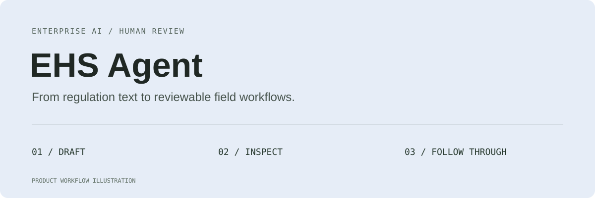
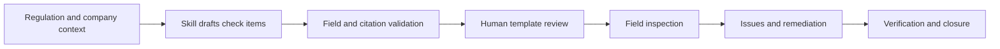
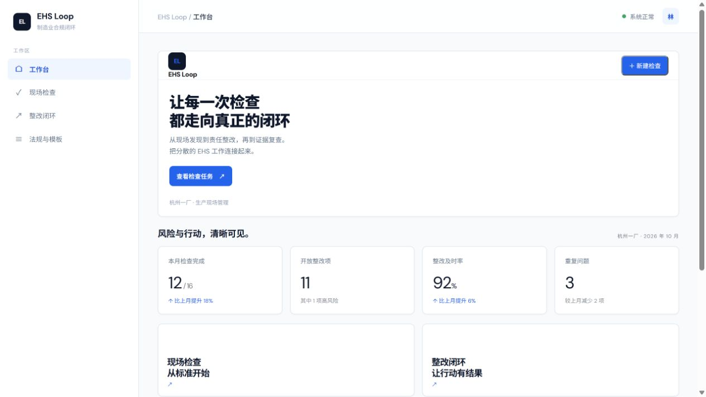

# EHS Agent

**English** · [中文](README.zh-CN.md)

### EHS Loop · Manufacturing inspections, remediation, and verification

**From regulation text to reviewable check items—and through to follow-up verification.**

[Product case study (中文)](docs/case-study.md) · [Current boundaries](#current-boundaries) · [Demo task](#start-with-this-demo-task)

> This repository currently contains product case documentation. Implementation descriptions below refer to the local EHS Loop prototype; application source code and a runnable release are not yet provided here.

## What it helps EHS practitioners do

“I have a workshop inspection next week. I need to turn regulations into a checklist people can execute on site, with a way to follow up on findings.”

EHS Loop connects regulations, templates, field inspections, issue records, remediation, and verification. The AI assistant proposes check-item drafts with source quotations, applicability conditions, evidence requirements, and verification points. People review the drafts before using them in inspections.

| Practitioner task | What the local prototype offers |
| --- | --- |
| Turn regulations into a checklist | Draft items using the selected regulation, industry, region, and company context |
| Check each item's basis | Bind stored article numbers and verbatim passages through paragraph IDs; validate references |
| Identify conditions and missing context | Display applicability conditions, required information, and uncovered obligations |
| Carry a checklist into an inspection | Review templates, create tasks, and record inspection results |
| Follow through on findings | Connect issue records to remediation and verification |

## Five decisions that connect evidence to action

### 01 Describe the inspection context before generating items

The same provision can have different implications for different processes and working conditions. Inputs include industry, region, and company/process notes. The model returns a context summary, additional information needed, and obligations not yet covered.

The design keeps missing information visible so a generic checklist is not mistaken for complete coverage of a company's obligations.

### 02 Maintain regulation-to-check generation as a Skill

Each generation reads the deployed Skill and examples. Its rules cover inspection objects, methods, criteria, evidence, applicability, the relationship to a source provision, remediation, and verification.

| Draft fields | What reviewers can assess |
| --- | --- |
| Inspection object, method, and criteria | Whether an item translates into an executable field action |
| Provision, quotation, and obligated party | Whether the basis is genuine and addresses the right party |
| Applicability conditions and reasoning | Whether it fits the current process and area |
| Priority and rationale | Why this item should be checked first |
| Evidence, remediation, and verification | How work continues after a finding |

Missing or empty runtime rule files produce an explicit error, preventing silent fallback to an outdated prompt.

### 03 Bind quotations in the backend

Stored regulation text is divided into passages with a `citationId`. The model selects passages; the backend binds their original wording and article numbers. Field and reference validation excludes nonconforming items and returns notices. If all items are excluded, the current logic makes one corrective retry.

**Quotation accuracy** and **correct applicability** are separate concerns. Binding original text reduces misquotation and splicing; qualified reviewers still need to assess whether a provision actually supports a proposed check.

### 04 Keep “pending verification” as a distinct state

Missing information calls for further checking. It must not count as completed work. The local prototype distinguishes pending verification from completed inspections and carries the new evidence and context fields into saved templates and tasks.

Inspection priority is also separate from the risk field, so “check this first” is not confused with an established incident risk classification.

### 05 Carry inspection findings into remediation and verification

The journey covers the company workspace, new inspections, field tasks, risk records, remediation tracking, and closure after verification. The core product question is: **Can a finding reach the next person with its context intact?**

*Actual local prototype interface. Factories, people, completion rates, risk counts, and changes shown are demo data—not real-company results or measured impact.*

The current backend persists data in JSON files, with interfaces intended to support a future database adapter. Organizational permissions, formal auditing, and production deployment still need work.

## Start with this demo task

> Prepare an inspection for a manufacturing workshop. Select a stored regulation and describe the process, area, and known working conditions. Generate drafts, check quotations, applicability, and missing information, then review the items to take on site.

| Step | What to observe |
| --- | --- |
| Generate drafts | Objects, methods, criteria, evidence, and source fields are visible |
| Check references | Article numbers and quotations map back to the selected stored text |
| Encounter missing conditions | Required information is shown and pending verification remains available |
| Identify a field issue | Remediation and verification records can follow |

This is a workflow demonstration, not a real-company audit result. The [product case study (中文)](docs/case-study.md) explains decisions and evaluation plans.

## How the agent supports the experience

| Module | Current local implementation |
| --- | --- |
| Generation inputs | Full selected regulation, stored version, industry, region, and company notes |
| Runtime rules | File-based Skill and examples read for each generation |
| Model service | Configurable model API called by the backend |
| Output controls | Field constraints, reference validation, exclusion notices, and corrective retry |
| Business workflow | Templates, inspections, issues, remediation, and verification |
| Persistence | JSON development adapter |

## Documentation and availability

| Entry | Contents |
| --- | --- |
| [Product case study (中文)](docs/case-study.md) | Problem, decisions, demo task, and evaluation plans |
| This README | Local prototype capabilities and the public documentation scope |

There are no clone-and-run instructions for this repository yet. A future source release should include runtime rules, example configuration, demo data, and validation instructions.

## Current boundaries

This is a prototype. Regulation versions and applicability require human verification. It does not automatically search company knowledge bases or external technical standards. Citation checks and Skill integration do not constitute professional compliance review. This document provides neither specific legal interpretations nor company compliance conclusions.

Production use still requires authentication, organization isolation, object storage, audit records, and reliable backups. No measured real-company pilots, incident reductions, or inspection efficiency gains are reported.
